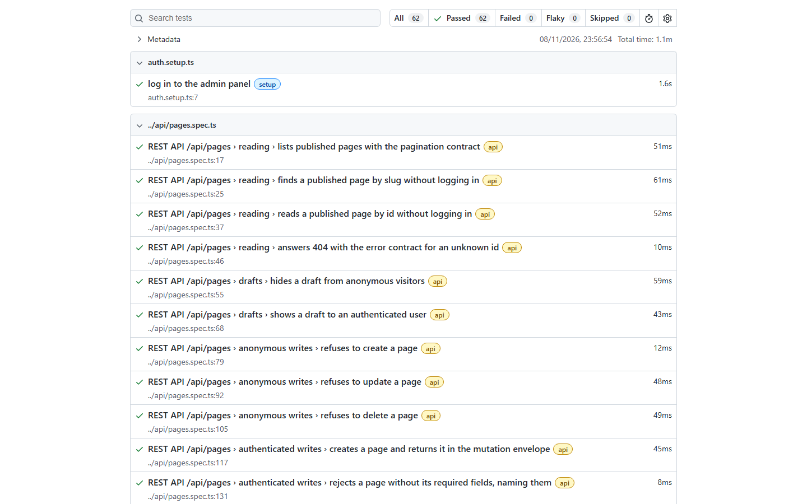
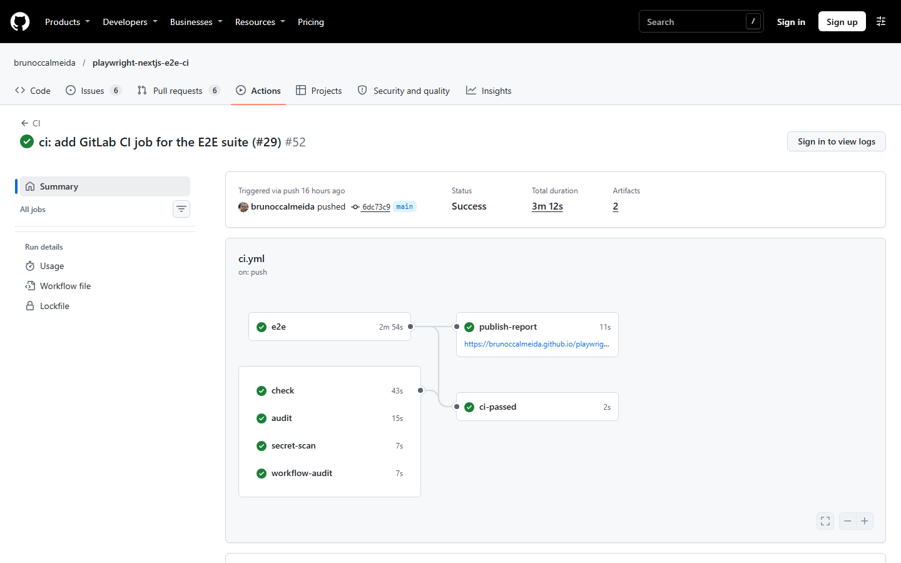
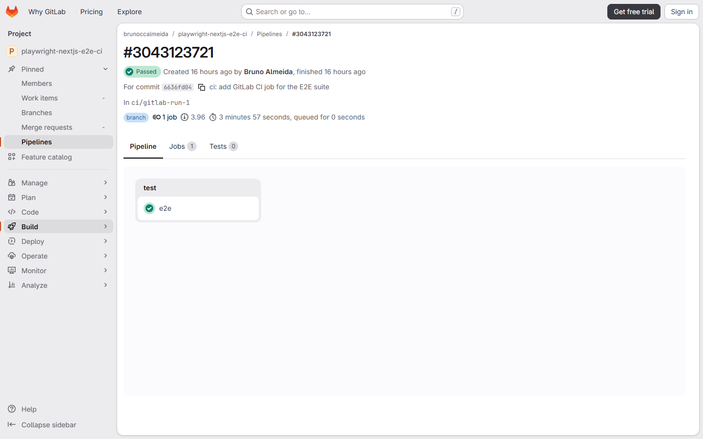

# Playwright E2E suite for a Next.js / Payload CMS app

[](https://github.com/brunoccalmeida/playwright-nextjs-e2e-ci/actions/workflows/ci.yml?query=branch%3Amain)

**English** | [Português (Brasil)](README.pt-BR.md)

A Playwright + TypeScript test suite for a Next.js 16 / Payload CMS website, running against the production build and a brand-new Postgres database on every `e2e` CI job. The application is the official [Payload Website Template](https://github.com/payloadcms/payload/blob/3.x/templates/website), kept frozen: bugs are reported and pinned by tests, not patched.

This is a personal portfolio project, not client work.

## At a Glance

| What                  | Result                                                   | Evidence                                                                                                                                                                                                                            |
| --------------------- | -------------------------------------------------------- | ----------------------------------------------------------------------------------------------------------------------------------------------------------------------------------------------------------------------------------- |
| Tests on `main`       | 63, all as expected                                      | [HTML report](https://brunoccalmeida.github.io/playwright-nextjs-e2e-ci/) (latest run on `main`)                                                                                                                                    |
| Pipeline              | 5 jobs behind one required `ci-passed` gate, 3m 12s      | [Run at `6dc73c9`](https://github.com/brunoccalmeida/playwright-nextjs-e2e-ci/actions/runs/42553516022), [workflow](.github/workflows/ci.yml), [ruleset](https://github.com/brunoccalmeida/playwright-nextjs-e2e-ci/rules/26807974) |
| Bugs found in the app | 8, each with a test asserting the correct behavior       | [Known issues](docs/KNOWN_ISSUES.md)                                                                                                                                                                                                |
| Second CI platform    | The same `e2e` job on GitLab.com, 62 of 62 at `6636fd0`  | [Job log](https://gitlab.com/brunoccalmeida1/playwright-nextjs-e2e-ci/-/jobs/17849067385), [green pipeline](https://gitlab.com/brunoccalmeida1/playwright-nextjs-e2e-ci/-/pipelines/3043123721), [`.gitlab-ci.yml`](.gitlab-ci.yml) |
| Stack                 | Playwright 1.63, Next.js 16.4, Payload 3.93, Postgres 18 | [`package.json`](package.json), [`compose.yaml`](compose.yaml)                                                                                                                                                                      |

**About "63 green":** the 8 bug tests use `test.fail()`, so the report counts them as passed while the bug exists. If a bug gets fixed, its test starts failing and asks for the marker to be removed.

| Area                                      | Tests | Where                                                                                                                                                            |
| ----------------------------------------- | ----- | ---------------------------------------------------------------------------------------------------------------------------------------------------------------- |
| REST API contract                         | 19    | [`tests/api/`](tests/api)                                                                                                                                        |
| Accessibility and keyboard                | 23    | [`accessibility.spec.ts`](tests/e2e/accessibility.spec.ts), [`keyboard.spec.ts`](tests/e2e/keyboard.spec.ts)                                                     |
| Homepage: desktop, mobile, reduced motion | 13    | [`homepage.spec.ts`](tests/e2e/homepage.spec.ts), [`.mobile`](tests/e2e/homepage.mobile.spec.ts), [`.reduced-motion`](tests/e2e/homepage.reduced-motion.spec.ts) |
| Contact form                              | 1     | [`contact-form.spec.ts`](tests/e2e/contact-form.spec.ts)                                                                                                         |
| CMS journey, admin panel to frontend      | 2     | [`cms.admin.spec.ts`](tests/e2e/cms.admin.spec.ts)                                                                                                               |
| Specs that came with the template         | 4     | [`admin.e2e.spec.ts`](tests/e2e/admin.e2e.spec.ts), [`frontend.e2e.spec.ts`](tests/e2e/frontend.e2e.spec.ts)                                                     |
| Admin login setup                         | 1     | [`auth.setup.ts`](tests/e2e/auth.setup.ts)                                                                                                                       |



_Screenshot from the 62-test run, before KI-8 was added._



## How this maps to a client brief

| A client usually asks for              | What is here                                                                                                    | Evidence                                                                                                                                                                                                                                                                       |
| -------------------------------------- | --------------------------------------------------------------------------------------------------------------- | ------------------------------------------------------------------------------------------------------------------------------------------------------------------------------------------------------------------------------------------------------------------------------ |
| User journeys tested in a real browser | An editor changes a page in the admin panel, and an anonymous visitor sees the published result                 | [`cms.admin.spec.ts`](tests/e2e/cms.admin.spec.ts)                                                                                                                                                                                                                             |
| API tests that catch breaking changes  | Response schemas for `/api/pages` and `/api/posts`, plus anonymous and authenticated permissions                | [`cms-contract.ts`](tests/helpers/cms-contract.ts), [`tests/api/`](tests/api)                                                                                                                                                                                                  |
| Accessibility checks                   | axe scans up to WCAG 2.2 AA in both color themes, and keyboard-only navigation                                  | [`axe.ts`](tests/helpers/axe.ts), [`accessibility.spec.ts`](tests/e2e/accessibility.spec.ts), [`keyboard.spec.ts`](tests/e2e/keyboard.spec.ts)                                                                                                                                 |
| Tests that can be trusted              | Each test written here was seen failing, before its support code existed or by mutation; the commits record how | Commits [`db83780`](https://github.com/brunoccalmeida/playwright-nextjs-e2e-ci/commit/db83780), [`ad6e89f`](https://github.com/brunoccalmeida/playwright-nextjs-e2e-ci/commit/ad6e89f), [`025581d`](https://github.com/brunoccalmeida/playwright-nextjs-e2e-ci/commit/025581d) |
| A repeatable test environment          | Each `e2e` job gets a new Postgres, migrations, seed data and its own generated secrets                         | [`ci.yml`](.github/workflows/ci.yml), [`scripts/seed.ts`](scripts/seed.ts)                                                                                                                                                                                                     |
| CI that blocks bad merges              | Types, lint, dependency audit, secret scan, workflow audit and E2E behind one gate                              | [Ruleset](https://github.com/brunoccalmeida/playwright-nextjs-e2e-ci/rules/26807974), [pull request held back by a failing probe commit](https://github.com/brunoccalmeida/playwright-nextjs-e2e-ci/pull/10)                                                                   |
| GitHub Actions or GitLab CI            | Both ran for real; GitHub is the source of truth, GitLab runs the `e2e` job                                     | [GitHub run](https://github.com/brunoccalmeida/playwright-nextjs-e2e-ci/actions/runs/42553516022), [GitLab pipeline](https://gitlab.com/brunoccalmeida1/playwright-nextjs-e2e-ci/-/pipelines/3043123721)                                                                       |
| Readable reports when something breaks | A public HTML report from `main`, and the report attached to any run whose tests fail                           | [Report](https://brunoccalmeida.github.io/playwright-nextjs-e2e-ci/), [deliberately failing GitLab pipeline](https://gitlab.com/brunoccalmeida1/playwright-nextjs-e2e-ci/-/pipelines/3043130956)                                                                               |
| Bugs reported clearly                  | Observed, expected, cause and impact for each defect                                                            | [Known issues](docs/KNOWN_ISSUES.md)                                                                                                                                                                                                                                           |

## Bugs found

All are in the generated app or its Payload dependency, and each one links to its full report. They are not all functional failures: KI-3 and KI-4 are accessibility findings from axe, and KI-5 is the cost of a deliberate rule against a flash of the wrong theme.

| Id                                                                                                                      | Bug                                                                                   | Impact   |
| ----------------------------------------------------------------------------------------------------------------------- | ------------------------------------------------------------------------------------- | -------- |
| [KI-1](docs/KNOWN_ISSUES.md#ki-1-homepage-title-repeats-the-site-name)                                                  | Homepage title repeats the site name                                                  | Low      |
| [KI-2](docs/KNOWN_ISSUES.md#ki-2-unmatched-nested-urls-show-the-default-nextjs-404-page)                                | Unmatched nested URLs show the default Next.js 404 page                               | Moderate |
| [KI-3](docs/KNOWN_ISSUES.md#ki-3-code-block-line-numbers-have-insufficient-contrast)                                    | Code block line numbers have insufficient contrast                                    | Low      |
| [KI-4](docs/KNOWN_ISSUES.md#ki-4-open-theme-selector-leaves-focusable-content-inside-aria-hidden-regions)               | Open theme selector leaves focusable content inside aria-hidden regions               | Low      |
| [KI-5](docs/KNOWN_ISSUES.md#ki-5-pages-are-blank-when-javascript-is-unavailable)                                        | Pages are blank when JavaScript is unavailable                                        | Moderate |
| [KI-6](docs/KNOWN_ISSUES.md#ki-6-a-newly-published-post-is-missing-from-the-posts-listing)                              | A newly published post is missing from the posts listing                              | Moderate |
| [KI-7](docs/KNOWN_ISSUES.md#ki-7-rest-validation-errors-lose-their-field-details-once-the-admin-panel-has-loaded-first) | REST validation errors lose their field details once the admin panel has loaded first | Low      |
| [KI-8](docs/KNOWN_ISSUES.md#ki-8-a-malformed-email-shows-the-generic-required-field-message)                            | A malformed email shows the generic required-field message                            | Low      |

## What this does not cover

- **Browsers:** Chromium only. The `mobile` project emulates a Pixel 7 on Chromium at 375x812; there is no Firefox, WebKit or real-device run.
- **Test types:** no load, visual regression or security testing of the app.
- **Accessibility:** automated scans and keyboard paths, not an audit with assistive technology.
- **The application:** no existing file under `src/` changed since the first commit ([comparison](https://github.com/brunoccalmeida/playwright-nextjs-e2e-ci/compare/f0154df...6dc73c9)), and only [generated migrations](src/migrations) were added. Commit [`51c76a2`](https://github.com/brunoccalmeida/playwright-nextjs-e2e-ci/commit/51c76a2) updated `next` and `sharp` for security fixes and corrected one template spec.
- **GitLab:** the mirror is updated by hand and runs only the `e2e` job.

## Run locally

Prerequisites: Docker, the Node.js version in `.node-version`, and pnpm through Corepack (`corepack enable`). The seed downloads its images from GitHub, so it needs internet access.

```bash
pnpm install --frozen-lockfile
cp .env.example .env   # local-only values that match compose.yaml
pnpm db:up             # starts Postgres and waits until it is healthy
pnpm db:migrate        # validates the environment and applies the migrations
pnpm db:seed           # replaces all content and media with the demo content
pnpm build
pnpm start
```

Open <http://localhost:3000>. The admin panel is at <http://localhost:3000/admin>, and the seed creates a demo login: `demo-author@example.com` / `password`.

- **Keep this order.** Static pages are generated during the build, so seeding after it leaves `/posts` empty for up to 10 minutes.
- **Keep this database in production mode.** Anything else that connects to it (`pnpm dev`, `pnpm test:int`, including the [template's Development steps](docs/PAYLOAD_TEMPLATE_README.md#development)) makes the Postgres adapter push the schema and mark the database as dev. The next `pnpm db:migrate` then stops at a data-loss prompt instead of migrating. To recover, run `pnpm db:down` and start again from `pnpm db:up`.
- **If the seed fails, do not build yet.** A failed seed can leave the database half cleared. Run `pnpm db:seed` again first. If you already built, remove `.next` before building again: `.next/cache` is shared between builds and keeps the empty header, even after a good seed.
- **Start over:** `pnpm db:down` deletes the database, then repeat from `pnpm db:up`.

## Run the end-to-end tests

After the steps above, up to `pnpm build`:

```bash
pnpm exec playwright install chromium   # once, and after every Playwright update
pnpm test:e2e                           # starts `pnpm start`, or reuses a running server
pnpm exec playwright show-report        # opens the HTML report
```

The tests run against the production build, so run `pnpm build` again after changing the app. Projects: `setup` (admin login), `api` (REST contract of `/api/pages` and `/api/posts`), `admin` (journey from the admin panel to the frontend), `chromium` (desktop), `mobile` (375x812) and `reduced-motion`.

The suite logs in with `E2E_ADMIN_EMAIL` and `E2E_ADMIN_PASSWORD`. A `.env` created before they were added to `.env.example` needs both lines, and the run stops at startup without them.

Defects found in the app are listed in [`docs/KNOWN_ISSUES.md`](docs/KNOWN_ISSUES.md).

An experiment with Playwright Test Agents, including where they conflict with these rules, is in [`docs/PLAYWRIGHT_AGENTS_EXPERIMENT.md`](docs/PLAYWRIGHT_AGENTS_EXPERIMENT.md).

## Continuous integration

Every pull request runs these jobs, and the `ci-passed` gate requires all of them:

| Job              | What it does                                                                                                       |
| ---------------- | ------------------------------------------------------------------------------------------------------------------ |
| `check`          | Types, lint, formatting and the repository sentinels (`pnpm check`)                                                |
| `audit`          | `pnpm audit --prod --audit-level=high`; accepted exceptions are listed per advisory in `pnpm-workspace.yaml`       |
| `secret-scan`    | gitleaks over the commits of each pull request and push                                                            |
| `workflow-audit` | zizmor over the workflows                                                                                          |
| `e2e`            | Migrate, seed, build, start and test in the official Playwright container, with a new Postgres and secrets per job |

When `e2e` fails, the HTML report is attached to the run as an artifact, and the server log is in the output of the test step. The report of the latest run on `main` that reached the tests is published at <https://brunoccalmeida.github.io/playwright-nextjs-e2e-ci/>.

### GitLab CI

The `e2e` job also runs on GitLab.com, from [`.gitlab-ci.yml`](.gitlab-ci.yml): same Playwright image, a Postgres service and the same migrate, seed, build and test sequence, on a Free-tier hosted runner. The container setup differs: it runs as root, without the `--init` and `--ipc=host` flags. GitHub stays the source of truth and runs every other gate. The [GitLab mirror](https://gitlab.com/brunoccalmeida1/playwright-nextjs-e2e-ci) is updated by hand, so the proof is one pipeline at one commit, not a live status: [green pipeline at `6636fd0`](https://gitlab.com/brunoccalmeida1/playwright-nextjs-e2e-ci/-/pipelines/3043123721), and a [deliberately failing one](https://gitlab.com/brunoccalmeida1/playwright-nextjs-e2e-ci/-/pipelines/3043130956) that shows the job going red and keeping the report as an artifact.



## Template documentation

The original Payload template documentation is kept, unchanged, in [`docs/PAYLOAD_TEMPLATE_README.md`](docs/PAYLOAD_TEMPLATE_README.md).
