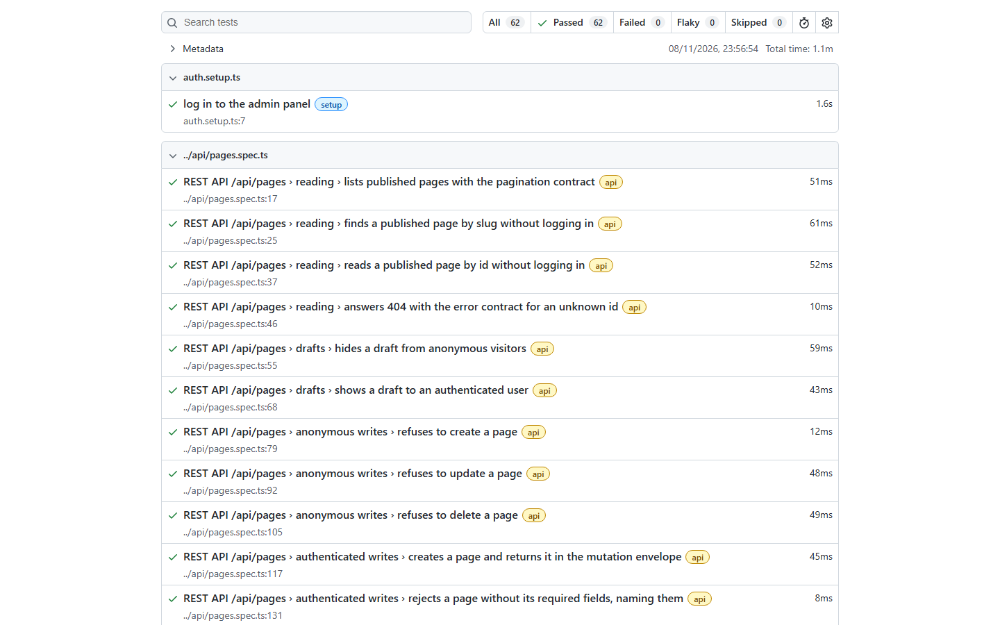
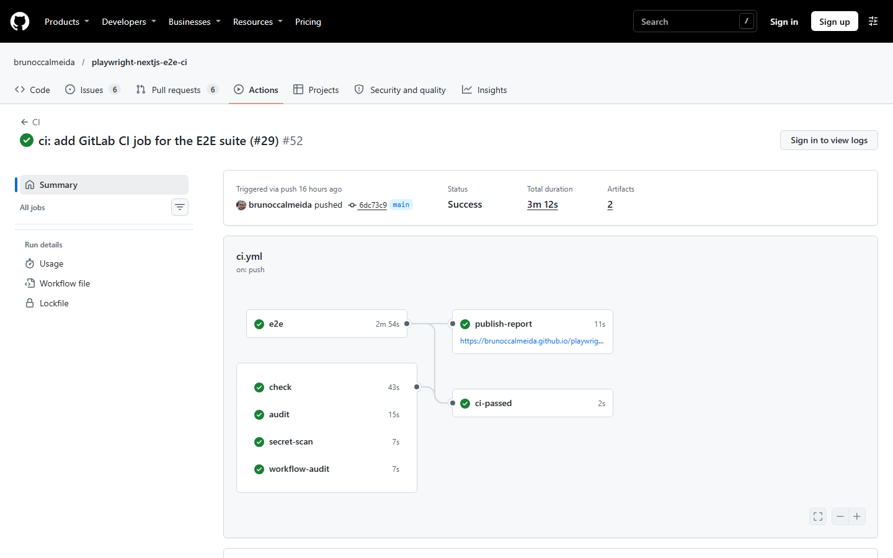
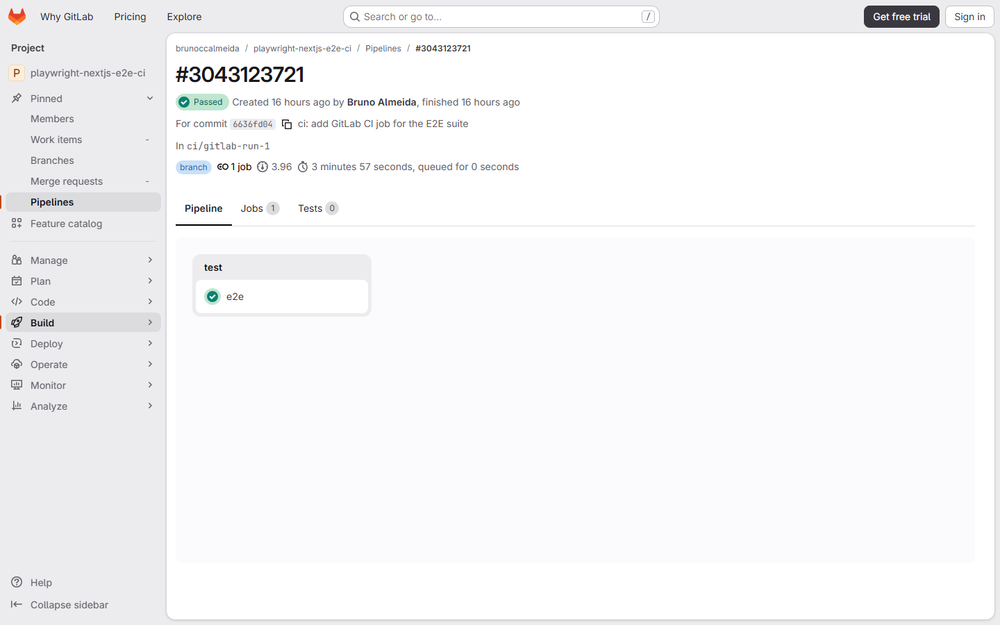

<!-- LTeX: language=pt-BR -->

# Suíte E2E com Playwright para um app Next.js / Payload CMS

[](https://github.com/brunoccalmeida/playwright-nextjs-e2e-ci/actions/workflows/ci.yml?query=branch%3Amain)

[English](README.md) | **Português (Brasil)**

Suíte de testes em Playwright + TypeScript para um site Next.js 16 / Payload CMS, executada contra o build de produção e um banco Postgres novo em cada execução do job `e2e`. A aplicação é o [Payload Website Template](https://github.com/payloadcms/payload/blob/3.x/templates/website) oficial, mantido congelado: bugs são relatados e fixados por testes, não corrigidos.

Este é um projeto pessoal de portfólio, não um trabalho para cliente.

## Visão geral

| O quê                    | Resultado                                                          | Evidência                                                                                                                                                                                                                                |
| ------------------------ | ------------------------------------------------------------------ | ---------------------------------------------------------------------------------------------------------------------------------------------------------------------------------------------------------------------------------------- |
| Testes na `main`         | 62, todos como esperado, em 1,1 min                                | [Relatório HTML](https://brunoccalmeida.github.io/playwright-nextjs-e2e-ci/) (última execução na `main`)                                                                                                                                 |
| Pipeline                 | 5 jobs atrás de um único gate obrigatório, `ci-passed`, em 3min12s | [Execução em `6dc73c9`](https://github.com/brunoccalmeida/playwright-nextjs-e2e-ci/actions/runs/42553516022), [workflow](.github/workflows/ci.yml), [ruleset](https://github.com/brunoccalmeida/playwright-nextjs-e2e-ci/rules/26807974) |
| Bugs encontrados no app  | 7, cada um com um teste que afirma o comportamento correto         | [Known issues](docs/KNOWN_ISSUES.md)                                                                                                                                                                                                     |
| Segunda plataforma de CI | O mesmo job `e2e` no GitLab.com, 62 de 62 em `6636fd0`             | [Log do job](https://gitlab.com/brunoccalmeida1/playwright-nextjs-e2e-ci/-/jobs/17849067385), [pipeline verde](https://gitlab.com/brunoccalmeida1/playwright-nextjs-e2e-ci/-/pipelines/3043123721), [`.gitlab-ci.yml`](.gitlab-ci.yml)   |
| Stack                    | Playwright 1.63, Next.js 16.4, Payload 3.93, Postgres 18           | [`package.json`](package.json), [`compose.yaml`](compose.yaml)                                                                                                                                                                           |

**Sobre os "62 verdes":** os 7 testes de bug usam `test.fail()`, então o relatório os conta como aprovados enquanto o bug existir. Se um bug for corrigido, o teste dele passa a falhar e pede a remoção da marcação.

| Área                                          | Testes | Onde                                                                                                                                                             |
| --------------------------------------------- | ------ | ---------------------------------------------------------------------------------------------------------------------------------------------------------------- |
| Contrato da REST API                          | 19     | [`tests/api/`](tests/api)                                                                                                                                        |
| Acessibilidade e teclado                      | 23     | [`accessibility.spec.ts`](tests/e2e/accessibility.spec.ts), [`keyboard.spec.ts`](tests/e2e/keyboard.spec.ts)                                                     |
| Homepage: desktop, mobile, movimento reduzido | 13     | [`homepage.spec.ts`](tests/e2e/homepage.spec.ts), [`.mobile`](tests/e2e/homepage.mobile.spec.ts), [`.reduced-motion`](tests/e2e/homepage.reduced-motion.spec.ts) |
| Jornada do CMS, do admin ao frontend          | 2      | [`cms.admin.spec.ts`](tests/e2e/cms.admin.spec.ts)                                                                                                               |
| Specs que vieram com o template               | 4      | [`admin.e2e.spec.ts`](tests/e2e/admin.e2e.spec.ts), [`frontend.e2e.spec.ts`](tests/e2e/frontend.e2e.spec.ts)                                                     |
| Setup de login no admin                       | 1      | [`auth.setup.ts`](tests/e2e/auth.setup.ts)                                                                                                                       |





## Como isto atende a um briefing de cliente

| O que um cliente costuma pedir                 | O que há aqui                                                                                                              | Evidência                                                                                                                                                                                                                                                                      |
| ---------------------------------------------- | -------------------------------------------------------------------------------------------------------------------------- | ------------------------------------------------------------------------------------------------------------------------------------------------------------------------------------------------------------------------------------------------------------------------------ |
| Jornadas de usuário testadas em navegador real | Um editor altera uma página no admin, e um visitante anônimo vê o resultado publicado                                      | [`cms.admin.spec.ts`](tests/e2e/cms.admin.spec.ts)                                                                                                                                                                                                                             |
| Testes de API que pegam quebras de contrato    | Schemas das respostas de `/api/pages` e `/api/posts`, mais permissões anônimas e autenticadas                              | [`cms-contract.ts`](tests/helpers/cms-contract.ts), [`tests/api/`](tests/api)                                                                                                                                                                                                  |
| Verificação de acessibilidade                  | Varreduras axe até WCAG 2.2 AA nos dois temas de cor, e navegação só por teclado                                           | [`axe.ts`](tests/helpers/axe.ts), [`accessibility.spec.ts`](tests/e2e/accessibility.spec.ts), [`keyboard.spec.ts`](tests/e2e/keyboard.spec.ts)                                                                                                                                 |
| Testes em que se pode confiar                  | Cada teste escrito aqui foi visto falhando, antes de o código de suporte existir ou por mutação; os commits registram como | Commits [`db83780`](https://github.com/brunoccalmeida/playwright-nextjs-e2e-ci/commit/db83780), [`ad6e89f`](https://github.com/brunoccalmeida/playwright-nextjs-e2e-ci/commit/ad6e89f), [`025581d`](https://github.com/brunoccalmeida/playwright-nextjs-e2e-ci/commit/025581d) |
| Ambiente de teste repetível                    | Cada job `e2e` recebe um Postgres novo, migrations, dados de seed e segredos gerados por execução                          | [`ci.yml`](.github/workflows/ci.yml), [`scripts/seed.ts`](scripts/seed.ts)                                                                                                                                                                                                     |
| CI que barra merges ruins                      | Tipos, lint, auditoria de dependências, varredura de segredos, auditoria de workflows e E2E atrás de um gate               | [Ruleset](https://github.com/brunoccalmeida/playwright-nextjs-e2e-ci/rules/26807974), [pull request barrado por um commit-sonda com falha](https://github.com/brunoccalmeida/playwright-nextjs-e2e-ci/pull/10)                                                                 |
| GitHub Actions ou GitLab CI                    | Os dois rodaram de verdade; o GitHub é a fonte da verdade, o GitLab roda o job `e2e`                                       | [Execução no GitHub](https://github.com/brunoccalmeida/playwright-nextjs-e2e-ci/actions/runs/42553516022), [pipeline no GitLab](https://gitlab.com/brunoccalmeida1/playwright-nextjs-e2e-ci/-/pipelines/3043123721)                                                            |
| Relatórios legíveis quando algo quebra         | Relatório HTML público da `main`, e o relatório anexado a qualquer execução com teste reprovado                            | [Relatório](https://brunoccalmeida.github.io/playwright-nextjs-e2e-ci/), [pipeline do GitLab reprovada de propósito](https://gitlab.com/brunoccalmeida1/playwright-nextjs-e2e-ci/-/pipelines/3043130956)                                                                       |
| Bugs relatados com clareza                     | Observado, esperado, causa e impacto de cada defeito                                                                       | [Known issues](docs/KNOWN_ISSUES.md)                                                                                                                                                                                                                                           |

## Bugs encontrados

Todos estão no app gerado ou na dependência Payload, e cada um leva ao relato completo (em inglês). Nem todos são falhas funcionais: KI-3 e KI-4 são achados de acessibilidade do axe, e KI-5 é o custo de uma regra deliberada contra o lampejo do tema errado.

| Id                                                                                                                      | Bug                                                                                 | Impacto  |
| ----------------------------------------------------------------------------------------------------------------------- | ----------------------------------------------------------------------------------- | -------- |
| [KI-1](docs/KNOWN_ISSUES.md#ki-1-homepage-title-repeats-the-site-name)                                                  | O título da homepage repete o nome do site                                          | Baixo    |
| [KI-2](docs/KNOWN_ISSUES.md#ki-2-unmatched-nested-urls-show-the-default-nextjs-404-page)                                | URLs aninhadas sem rota mostram a página 404 padrão do Next.js                      | Moderado |
| [KI-3](docs/KNOWN_ISSUES.md#ki-3-code-block-line-numbers-have-insufficient-contrast)                                    | Os números de linha dos blocos de código têm contraste insuficiente                 | Baixo    |
| [KI-4](docs/KNOWN_ISSUES.md#ki-4-open-theme-selector-leaves-focusable-content-inside-aria-hidden-regions)               | O seletor de tema aberto deixa conteúdo focável em regiões `aria-hidden`            | Baixo    |
| [KI-5](docs/KNOWN_ISSUES.md#ki-5-pages-are-blank-when-javascript-is-unavailable)                                        | As páginas ficam em branco quando o JavaScript não está disponível                  | Moderado |
| [KI-6](docs/KNOWN_ISSUES.md#ki-6-a-newly-published-post-is-missing-from-the-posts-listing)                              | Um post recém-publicado não aparece na listagem de posts                            | Moderado |
| [KI-7](docs/KNOWN_ISSUES.md#ki-7-rest-validation-errors-lose-their-field-details-once-the-admin-panel-has-loaded-first) | Erros de validação da REST perdem o detalhe dos campos se o admin carregou primeiro | Baixo    |

## O que isto não cobre

- **Navegadores:** só Chromium. O projeto `mobile` emula um Pixel 7 no Chromium em 375x812; não há execução em Firefox, WebKit ou aparelho real.
- **Tipos de teste:** sem teste de carga, regressão visual ou segurança do app.
- **Acessibilidade:** varreduras automáticas e caminhos de teclado, não uma auditoria com tecnologia assistiva.
- **A aplicação:** nenhum arquivo existente em `src/` mudou desde o primeiro commit ([comparação](https://github.com/brunoccalmeida/playwright-nextjs-e2e-ci/compare/f0154df...6dc73c9)), e só foram adicionadas [migrations geradas](src/migrations). O commit [`51c76a2`](https://github.com/brunoccalmeida/playwright-nextjs-e2e-ci/commit/51c76a2) atualizou `next` e `sharp` por correções de segurança e corrigiu um spec do template.
- **GitLab:** o espelho é atualizado à mão e roda só o job `e2e`.

## Rodar localmente

Pré-requisitos: Docker, a versão do Node.js em `.node-version` e pnpm via Corepack (`corepack enable`). O seed baixa as imagens do GitHub, então precisa de internet.

```bash
pnpm install --frozen-lockfile
cp .env.example .env   # valores só locais, compatíveis com o compose.yaml
pnpm db:up             # sobe o Postgres e espera ficar saudável
pnpm db:migrate        # valida o ambiente e aplica as migrations
pnpm db:seed           # substitui todo o conteúdo e a mídia pelo conteúdo demo
pnpm build
pnpm start
```

Abra <http://localhost:3000>. O painel admin fica em <http://localhost:3000/admin>, e o seed cria um login demo: `demo-author@example.com` / `password`.

- **Mantenha esta ordem.** As páginas estáticas são geradas no build, então um seed depois dele deixa `/posts` vazio por até 10 minutos.
- **Mantenha este banco em modo de produção.** Qualquer outra conexão a ele (`pnpm dev`, `pnpm test:int`, inclusive os [passos de Development do template](docs/PAYLOAD_TEMPLATE_README.md#development)) faz o adaptador Postgres aplicar o schema e marcar o banco como dev. O próximo `pnpm db:migrate` então para num prompt de perda de dados em vez de migrar. Para recuperar, rode `pnpm db:down` e recomece em `pnpm db:up`.
- **Recomeçar:** `pnpm db:down` apaga o banco; depois repita a partir de `pnpm db:up`.

## Rodar os testes end-to-end

Depois dos passos acima, até `pnpm build`:

```bash
pnpm exec playwright install chromium   # uma vez, e depois de cada atualização do Playwright
pnpm test:e2e                           # sobe o `pnpm start` ou reutiliza um servidor no ar
pnpm exec playwright show-report        # abre o relatório HTML
```

Os testes rodam contra o build de produção, então rode `pnpm build` de novo depois de mudar o app. Projetos: `setup` (login no admin), `api` (contrato REST de `/api/pages` e `/api/posts`), `admin` (jornada do painel admin ao frontend), `chromium` (desktop), `mobile` (375x812) e `reduced-motion`.

A suíte entra com `E2E_ADMIN_EMAIL` e `E2E_ADMIN_PASSWORD`. Um `.env` criado antes de essas variáveis entrarem no `.env.example` precisa das duas linhas, e sem elas a execução para na inicialização.

Os defeitos encontrados no app estão em [`docs/KNOWN_ISSUES.md`](docs/KNOWN_ISSUES.md).

## Integração contínua

Todo pull request roda estes jobs, e o gate `ci-passed` exige todos:

| Job              | O que faz                                                                                                        |
| ---------------- | ---------------------------------------------------------------------------------------------------------------- |
| `check`          | Tipos, lint, formatação e as sentinelas do repositório (`pnpm check`)                                            |
| `audit`          | `pnpm audit --prod --audit-level=high`; as exceções aceitas ficam listadas por advisory em `pnpm-workspace.yaml` |
| `secret-scan`    | gitleaks nos commits de cada pull request e push                                                                 |
| `workflow-audit` | zizmor nos workflows                                                                                             |
| `e2e`            | Migra, faz seed, build, sobe e testa no container oficial do Playwright, com Postgres e segredos novos por job   |

Quando o `e2e` falha, o relatório HTML fica anexado à execução como artifact, e o log do servidor fica na saída do passo de teste. O relatório da última execução na `main` que chegou aos testes é publicado em <https://brunoccalmeida.github.io/playwright-nextjs-e2e-ci/>.

### GitLab CI

O job `e2e` também roda no GitLab.com, a partir do [`.gitlab-ci.yml`](.gitlab-ci.yml): mesma imagem do Playwright, um serviço Postgres e a mesma sequência de migrate, seed, build e testes, num runner hospedado do plano Free. O container difere: roda como root, sem as flags `--init` e `--ipc=host`. O GitHub continua sendo a fonte da verdade e roda todos os outros portões. O [espelho no GitLab](https://gitlab.com/brunoccalmeida1/playwright-nextjs-e2e-ci) é atualizado à mão, então a prova é uma pipeline em um commit, não um status ao vivo: [pipeline verde em `6636fd0`](https://gitlab.com/brunoccalmeida1/playwright-nextjs-e2e-ci/-/pipelines/3043123721) e uma [reprovada de propósito](https://gitlab.com/brunoccalmeida1/playwright-nextjs-e2e-ci/-/pipelines/3043130956), que mostra o job ficando vermelho e mantendo o relatório como artifact.



## Documentação do template

A documentação original do template da Payload continua, sem alterações, em [`docs/PAYLOAD_TEMPLATE_README.md`](docs/PAYLOAD_TEMPLATE_README.md).
